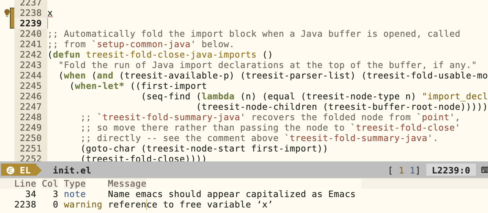

# Flymake for Emacs Lisp

## Introduction
Flymake is an integral part of how I generally handle programming modes, and I have invested a decent amount of time in configuring it to work like I want in my config files. But, strangely, on reflection I had never used it for elisp files. Partly I hadn't even considered it was possible, and I've only recently become more serious about treating my init.el and various packages as first-class coding projects.

This all changed recently, when I realized it was a really nice tool for handling one of my persistent typing issues. I'm a bit of a sloppy typist and tend to occasionally leave random keystrokes littered around files by mistake as I move around. Usually these are fragments of a command where I didn't press control where expected, or perhaps I was in the wrong window. The classic one for me is to leave a single 'x' somewhere in the file. If you've ever done this and restarted Emacs, you'll be greeted by:

```
⛔ Warning (initialization): An error occurred while loading ‘/Users/benjamin.leis/.emacs.d/init.el’:

Symbol’s value as variable is void: x

To ensure normal operation, you should investigate and remove the
cause of the error in your initialization file.  Start Emacs with
the ‘--debug-init’ option to view a complete error backtrace.
```

This unfortunately doesn't have a line number in the error, and x is a very small single character to spot. Worse, running with `--debug-init` isn't a ton more helpful by default.

```
Debugger entered--Lisp error: (void-variable x)
  load-with-code-conversion("/Users/benjamin.leis/.emacs.d/init.el" "/Users/benjamin.leis/.emacs.d/init.el" t t)
  load("/Users/benjamin.leis/.emacs.d/init" noerror nomessage)
  #f(compiled-function () #<bytecode 0x12e013913ccd9b11>)()
  #f(compiled-function () #<bytecode -0x4307d7bb01d2857>)()
  handler-bind-1(#f(compiled-function () #<bytecode -0x4307d7bb01d2857>) (error) startup--debug)
  startup--load-user-init-file(#f(compiled-function () #<bytecode 0x427c452a4e550fb>) #f(compiled-function () #<bytecode 0x731968ef8c5349b>) t)
  command-line()
  normal-top-level()
```

## Enter Flymake

I realized very recently that Flymake is actually really great for flushing out these typos. For
elisp, it's based on doing a byte-compile and will show the exact line where the issue originates
from. So I went to turn it on and immediately ran into some issues.

1. It's fairly strict about function and variable declarations being present within a file, and as a result mine had a bunch of false positive warnings.
2. It's also strict about docstrings, their format, and two spaces after periods. This also produced a low signal-to-noise ratio.
3. I'm using Elpaca as my package manager, and this added a few wrinkles to making it fully function.

## Fixing the UI
The first issue I had was that my mode line segment for Flymake was set to only be added when in Eglot
mode. This was all on me, and I switched it to the following:

```
(defun my-flymake-segment ()
  "Flymake's error/warning/note counter, shown when `flymake-mode' is on.
Click (mouse-1) anywhere in the segment to toggle flymake's diagnostics
list for the buffer, even when it's currently empty.
While a backend is still running and hasn't reported yet, a ⟳ glyph is
shown after the counters and the tooltip also says \"flymake is running\"."
  (when (bound-and-true-p flymake-mode)
    (let* ((counters (format-mode-line flymake-mode-line-counters))
           (checking (seq-difference (flymake-running-backends)
                                     (flymake-reporting-backends)))
           (busy (propertize "⟳" 'face 'compilation-mode-line-run)))
      (propertize (cond ((not checking)
                         (if (string-empty-p counters) "  OK  " counters))
                        ((string-empty-p counters) (concat "  " busy "  "))
                        (t (concat (string-trim-right counters) " " busy " ")))
                  ;; flymake's counters carry their own `keymap' property
                  ;; (mouse-1 -> show-only), which outranks `local-map'.
                  'keymap my-flymake-modeline-map
                  'local-map my-flymake-modeline-map
                  'mouse-face 'mode-line-highlight
                  'help-echo (concat (if checking "flymake is running\n" "")
                                     "mouse-1: toggle flymake diagnostics")))))
```

In particular, I now test whether to display it just on whether `flymake-mode` is active rather than on whether Eglot is active.

## Predeclaring functions and variables
I was a bit daunted initially when presented with 200+ of these warnings. The easiest first course of action was just to go one by one and add
various `declare-function` or `defvar` statements as needed.

```
;; Examples
(defvar org-capture-templates)
(declare-function org-agenda-maybe-redo "org-agenda")
```

This worked but added a fair amount of clutter throughout my init files. So the next step was to
consolidate them all into one section at the top. And then I thought: what if I move them out to
another file? The immediate answer is that it doesn't work directly, because these declarations are file-local. But we can overcome that issue via a macro that reads them in from a file and inserts them locally
in a large `progn` form, which then just gets evaluated after it's returned.

```
;; The predeclarations that keep this file warning-clean live in lisp/compile-declarations.el.
;; They have to be spliced into this file (a `require' would not carry bare `defvar' or
;; `declare-function' across files), hence the macro.
(eval-and-compile
  (defmacro my-include-declarations ()
    "Expand to the forms in lisp/compile-declarations.el, or nil when not compiling."
    (when (bound-and-true-p byte-compile-current-file)
      (let ((file (expand-file-name "lisp/compile-declarations.el" user-emacs-directory))
            forms)
        (with-temp-buffer
          (insert-file-contents file)
          (goto-char (point-min))
          (condition-case nil
              (while t (push (read (current-buffer)) forms))
            (end-of-file nil)))
        `(progn ,@(nreverse forms))))))
(my-include-declarations)
```

## Reducing the number of predeclarations
### Properly leverage use-package
The next thing I really wanted to do was optimize the number of predeclarations needed. The first
improvement came from some advice on Reddit: make sure all usage of a variable or function in a
`use-package` occurs in a `:config` section rather than at the top level. I was fairly cavalier about
doing this in the past because it didn't seem important. But by making sure the references aren't
invoked until after package load, a large group of fixups was eliminated.

```
;; Original

(use-package appt
  :ensure nil
  :config
  (setq appt-message-warning-time 10))

(setq appt-display-format 'mode)
(setq appt-display-diary nil)
(appt-activate t)

;; Fixup
(use-package appt
  :ensure nil
  :config
  (setq appt-message-warning-time 10)

  ;; Only do mode line notifications - my calendar is already sync'ed
  ;; with the OS notification center. Emacs isn't the source of truth.
  (setq appt-display-format 'mode)

  ;; don't do a popup on activation of the diary.
  (setq appt-display-diary nil)

  ;; Activate appointment notifications
  (appt-activate t))
```

### Loading all the packages
The next issue was another group of fixups that seemed unnecessary. They were in `use-package` blocks and
should have been OK. After investigating, it turned out that Elpaca was the root of the issue.
First, when byte-compiling, Emacs doesn't actually process macros, so many of those blocks were just
dropped. This, in fact, is noted frequently online. Byte-compiled files have to be very careful about
wrapping macros, including `use-package`, inside `eval-and-compile` blocks.

The second problem is that byte compilation runs without most of the default package manager settings
set up, including the location of the build files that Elpaca generates. That means even when loaded,
the process is relatively expensive and forces recompilation of any packages involved. This can be
quite expensive and requires going out to the network. I measured multi-minute delays initially. By
just passing the build paths that are already locally present, all of this expense can be avoided.

Finally, and this only became evident when I started testing, explicitly bringing Elpaca in during
byte compilation suppressed some of the expected warnings I tried to trigger. This was probably the
trickiest investigation. What turned out to be the case was that Elpaca silently changes several byte-compile
settings I was interested in (`byte-compile-delete-errors` and
`byte-optimize`). To make them work, I had to surround its invocation in a `let` form with local definitions so the global
byte-compile behavior was left untouched.

```
;; Elpaca macros (`elpaca') need to be known at compile time to expand rather than being compiled
;; as function calls.  Only done while compiling: loading elpaca before init.el's bootstrap has
;; defined `elpaca-installer-version' triggers elpaca's "installer version does not match" warning.
;; This is a no-op when elpaca isn't on the `load-path'.
;; elpaca.el has `(cl-declaim (optimize (safety 0)))', which sets `byte-compile-delete-errors' for
;; the rest of the compile and silently drops bare top-level symbols (a stray `oops' goes
;; unreported), so the loads below rebind it (and `byte-optimize') to undo that.
(eval-when-compile
  (let ((byte-compile-delete-errors byte-compile-delete-errors)
        (byte-optimize byte-optimize))
    (when (bound-and-true-p byte-compile-current-file)
      (add-to-list 'load-path (expand-file-name "elpaca/builds/elpaca" user-emacs-directory))
      (require 'elpaca nil t)
      ;; A bare `emacs -Q' compile (flymake) has no elpaca-use-package, so elpaca-style :ensure specs
      ;; fail to parse and package.el refreshes the archives over the network.  Already active when
      ;; compiling from the running session.
      (when (and (featurep 'elpaca) (not (bound-and-true-p elpaca-use-package-mode)))
        (require 'use-package)
        (when (require 'elpaca-use-package nil t)
          (elpaca-use-package-mode)
          (with-no-warnings (setq use-package-always-ensure t)))))))
```

### Load all the deferred packages
After all of this I was still having to define a group of symbols that I knew should be present. The
common link was that these were all deferred packages in `use-package`, which meant that during
compilation they weren't loaded before references. The quick solution I had was to just manually
require them when doing a byte-compile.

```
(eval-when-compile
  (let ((byte-compile-delete-errors byte-compile-delete-errors)
        (byte-optimize byte-optimize))
    (dolist (feature '(tab-line ispell flyspell eglot jsonrpc flymake ediff ediff-util ediff-wind
                       org org-agenda org-clock org-element dape dape-java treesit treesit-fold
                       pulsar diff-hl markdown-mode imenu desktop dired diary-lib cl-lib zone
                       pixel-scroll profiler modus-themes excorporate wikimode ghostel
                       ghostel-links consult vertico marginalia yasnippet gcmh nerd-icons))
      (condition-case nil (require feature nil t) (error nil)))))
```

## Conclusion
After doing all these steps, Flymake results were  finally showing as clean and quickly reflected an expected
error, as shown below, complete with the line number!  For the future, I've added a hook to turn it
on automatically in elisp mode. 

`(add-hook 'emacs-lisp-mode-hook #'flymake-mode)`

  The modeline notifications will hopefully keep me honest and not letting warnings and errors creep back in.



# References

[my compile declaration file](../lisp/compile-declarations.el)
