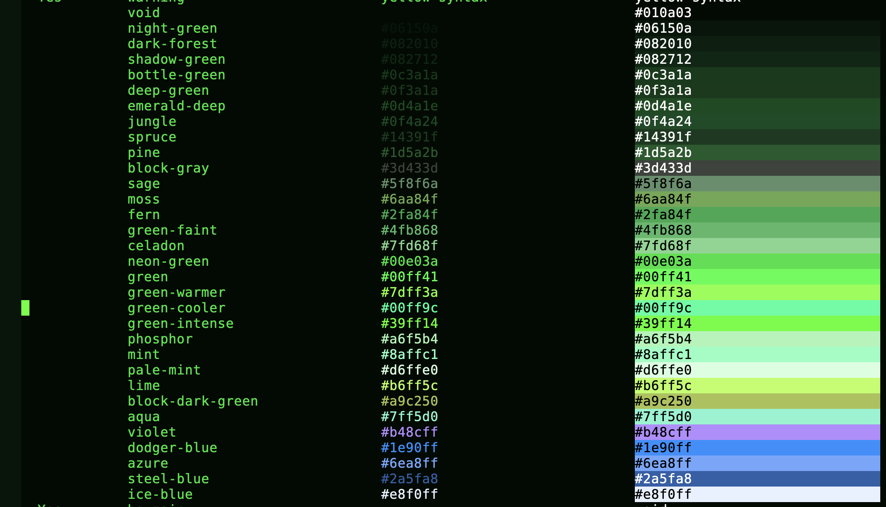

# modus

# Commentary:

A dark theme built on top of `modus-themes` where nearly everything is a
shade of green on a near-black green background.  Purple and
blue are used sparingly for emphasis (keybindings, constants, links,
a couple of headings).  Errors/warnings keep their modus red/yellow so
functional distinctions stay legible.  The palette is also fairly restrained
with its usage. For example all headings are the same color.

Customize `modus-vivendi-matrix-palette-overrides` to tweak further, the
same way you would with any other modus theme.



# Code:
<!-- markdown-toc start - Don't edit this section. Run M-x markdown-toc-refresh-toc -->
**Table of Contents**

- [modus](#modus)
- [Commentary:](#commentary)
- [Code:](#code)
- [modus-vivendi-matrix-theme.el ends here](#modus-vivendi-matrix-themeel-ends-here)

<!-- markdown-toc end -->

```
(unless (and (fboundp 'require-theme)
             load-file-name
             (equal (file-name-directory load-file-name)
                    (expand-file-name "themes/" data-directory))
             (require-theme 'modus-themes t))
  (require 'modus-themes))

(defcustom modus-vivendi-matrix-palette-user nil
  "Like `modus-vivendi-matrix-palette-overrides', for user-defined entries.
This is meant to extend the palette with custom named colors and/or
semantic palette mappings."
  :group 'modus-themes
  :type '(repeat (list symbol (choice symbol string)))
  :link '(info-link "(modus-themes) Option to extend the palette for use with overrides"))

(defconst modus-vivendi-matrix-palette
  (append
   '(;; Named colors: every hex value lives here, and is referenced by
     ;; name everywhere else.
     ;; Backgrounds and borders, near-black to dark green.
     (void         "#010a03")
     (night-green  "#06150a")
     (dark-forest  "#082010")
     (shadow-green "#082712")
     (bottle-green "#0c3a1a")
     (deep-green   "#0f3a1a")
     (emerald-deep "#0d4a1e")
     (jungle       "#0f4a24")
     (spruce       "#14391f")
     (pine         "#1d5a2b")
     (block-gray   "#3d433d")

     ;; Greens, dark to bright.
     (sage          "#5f8f6a")
     (moss          "#6aa84f")
     (fern          "#2fa84f")
     (green-faint   "#4fb868")
     (celadon       "#7fd68f")
     (neon-green    "#00e03a")
     (green         "#00ff41")
     (green-warmer  "#7dff3a")
     (green-cooler  "#00ff9c")
     (green-intense "#39ff14")
     (phosphor      "#a6f5b4")
     (mint          "#8affc1")
     (pale-mint     "#d6ffe0")
     (lime          "#b6ff5c")
     (block-dark-green "#a9c250")
     (aqua          "#7ff5d0")

     ;; Purples and blues.
     (violet       "#b48cff")
     (dodger-blue  "#1e90ff")
     (azure        "#6ea8ff")
     (steel-blue   "#2a5fa8")
     (ice-blue     "#e8f0ff")

     ;; Basic values: near-black green background, soft green foreground.
     (bg-main     void)
     (bg-dim      night-green)
     (fg-main     neon-green)
     (fg-dim      sage)
     (fg-alt      celadon)
     (bg-active   deep-green)
     (bg-inactive dark-forest)
     (border      pine)

     ;; General mappings
     (cursor     green-intense)
     (keybind    violet)
     (name       mint)
     (identifier green-faint)

     (bg-active-argument bg-green-nuanced)
     (fg-active-argument green)
     (bg-active-value    bg-green-nuanced)
     (fg-active-value    green-cooler)

     ;; Code mappings
     (builtin      violet)
     (comment      fg-dim)
     (constant     azure)
     (docstring    green-faint)
     (fnname       green)
     (fnname-call  phosphor)
     (keyword      green-intense)
     (preprocessor fern)
     (property     mint)
     (rx-backslash violet)
     (rx-construct green-cooler)
     (string       lime)
     (type         green-cooler)
     (variable     moss)
     (variable-use fg-alt)

     ;; Accent + completion-match mappings
     (accent-0 green)
     (accent-1 green-cooler)
     (accent-2 violet)
     (accent-3 lime)
     (fg-completion-match-0 green)
     (fg-completion-match-1 violet)
     (fg-completion-match-2 green-cooler)
     (fg-completion-match-3 lime)

     ;; Mode line
     (bg-mode-line-active       emerald-deep)
     (fg-mode-line-active       pale-mint)
     (border-mode-line-active   fern)
     (bg-mode-line-inactive     dark-forest)
     (fg-mode-line-inactive     fg-dim)
     (border-mode-line-inactive spruce)

     ;; Region, current line, completion popup, paren match
     (bg-region      jungle)
     (fg-region      pale-mint)
     (bg-hl-line     shadow-green)
     (bg-completion  bottle-green)
     (bg-paren-match steel-blue)
     (fg-paren-match ice-blue)

     ;; Search
     (bg-search-current bg-green-intense)
     (bg-search-lazy    bg-green-subtle)
     (bg-search-replace bg-magenta-subtle)

     ;; Links
     (fg-link                 indigo)
     (underline-link          indigo)
     (fg-link-symbolic        indigo)
     (underline-link-symbolic indigo)
     (fg-link-visited         indigo)
     (underline-link-visited  indigo)

     ;; Prompts and prose
     (fg-prompt         green-intense)
     (fg-prose-code     block-dark-green)
     (fg-prose-macro    violet)
     (fg-prose-verbatim lime)

     ;; Rainbow delimiters / outline levels
     (rainbow-0 fg-main)
     (rainbow-1 green)
     (rainbow-2 green-cooler)
     (rainbow-3 lime)
     (rainbow-4 violet)
     (rainbow-5 fern)
     (rainbow-6 mint)
     (rainbow-7 azure)
     (rainbow-8 moss))
   modus-themes-vivendi-palette)
  "The `modus-vivendi-matrix' palette: `modus-themes-vivendi-palette'
with its entries overridden in place to favor Matrix-style greens.
To customize the theme, use `modus-vivendi-matrix-palette-overrides'
or `modus-vivendi-matrix-palette-user' instead.")

(defcustom modus-vivendi-matrix-palette-overrides
  '((fg-heading-0 fern)
    (fg-heading-1 fern)
    (fg-heading-2 fern)
    (fg-heading-3 fern)
    (fg-heading-4 fern)
    (fg-heading-5 fern)
    (fg-heading-6 fern)
    (fg-heading-7 fern)
    (fg-heading-8 fern))
  "Overrides for `modus-vivendi-matrix-palette'.
The default colors every heading level `fern'; this is done here rather
than in the palette so it wins over `modus-themes-common-palette-overrides'.
Mirror the elements of `modus-vivendi-matrix-palette' (or the base modus
palette) to override their value, the same way you would with e.g.
`modus-vivendi-palette-overrides'."
  :group 'modus-themes
  :type '(repeat (list symbol (choice symbol string))))

(defconst modus-vivendi-matrix-custom-faces
  '(`(org-block ((,c :inherit modus-themes-fixed-pitch :background ,block-gray :foreground ,block-dark-green :extend t)))
    `(markdown-code-face ((,c :inherit modus-themes-fixed-pitch :background ,block-gray :foreground ,block-dark-green :extend t)))
    `(markdown-pre-face ((,c :inherit modus-themes-fixed-pitch :background ,block-gray :foreground ,block-dark-green :extend t)))
    `(markdown-header-face-1 ((,c :inherit modus-themes-heading-1 :foreground ,green-intense)))
    `(markdown-header-face-2 ((,c :inherit modus-themes-heading-2 :foreground ,green-intense)))
    `(markdown-header-face-3 ((,c :inherit modus-themes-heading-3 :foreground ,green-intense)))
    `(markdown-header-face-4 ((,c :inherit modus-themes-heading-4 :foreground ,green-intense)))
    `(markdown-header-face-5 ((,c :inherit modus-themes-heading-5 :foreground ,green-intense)))
    `(markdown-header-face-6 ((,c :inherit modus-themes-heading-6 :foreground ,green-intense)))
    `(markdown-link-face ((,c :background ,bg-link :foreground ,phosphor :underline ,phosphor)))
    `(markdown-url-face ((,c :background ,bg-link :foreground ,phosphor))))
  "Face specs evaluated by `modus-themes-theme' with palette colors bound.")

(modus-themes-theme
 'modus-vivendi-matrix
 'modus-themes-matrix
 "A `modus-vivendi' derivative in Matrix greens with purple/blue accents."
 'dark
 'modus-vivendi-matrix-palette
 'modus-vivendi-matrix-palette-user
 'modus-vivendi-matrix-palette-overrides
 'modus-vivendi-matrix-custom-faces)

(provide-theme 'modus-vivendi-matrix)
```

# modus-vivendi-matrix-theme.el ends here

> This file was auto-generated by elispdoc.el
