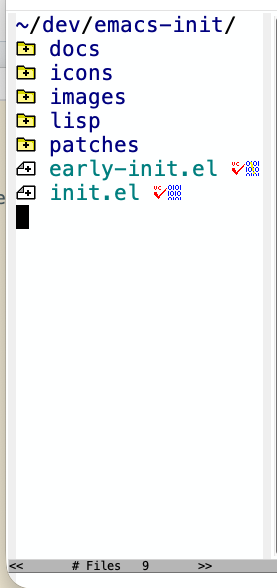
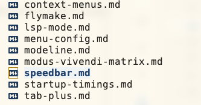
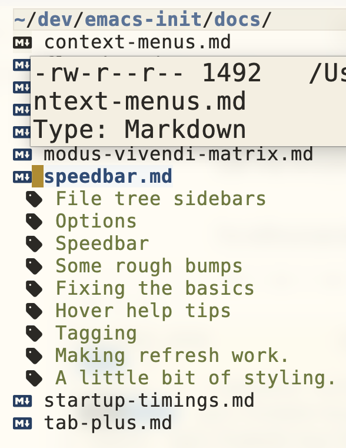

# File tree sidebars
A few years ago, when I thought it might be useful, I wired treemacs into my configuration and bound
it to C-1. It worked without much tuning at all but I never really used it. All of my file
management is typically done in terminals. And when I am programming, I tend to stay within the
project.el interfaces as well along with my use of imenu and ilist-plus for code structure
visualization. Then at some point when I moved to elpaca, I never reinstalled treemacs and failed to
notice that until I pressed C-1 by mistake when I meant to press C-2 and noticed the error message
about the nonexistent function. Several easy options were possible at this point. I could reinstall
treemacs and actually reference it in my config file with a use-package statement or I could remove
the key binding. But I thought it may be an opportunity to rethink this scenario and check out some
other alternatives.

# Options
In addition to treemacs, there is neo-tree, dired-sidebar and the builtin speedbar. They are not
all the same but have a tree structured buffer at the heart. Two seemed promising.
Dired-sidebar embeds a true dired buffer and therefore maintains consistent keybindings. As I
mentioned above I have never seriously adopted dired due to my love for bash but if I did do so this
would be very compelling. I gave it a brief try out and it mostly worked off the shelf although I
didn't quite get it to track the active buffer (I'm sure that is possible but I only briefly
investigated one setting). It also is project oriented and will open the project root for a buffer
rather than the current directory. To the extent I intend to ever use a file tree, that is not the
workflow I want. A directory window should be project aware but it's not to that length. I don't use
project trees much even in other coding tools like IntelliJ due to this preference.

# Speedbar 
Speedbar was interesting because it's built in and requires no additional packages. Originally when
written it launched a separate frame which would have been a deal killer for me, but in emacs 31
there is a new option to run it as a sidebar.

```
(with-eval-after-load 'speedbar
  ;; don't use a separate frame,
  (setq speedbar-prefer-window t))
```

This felt like it could be a cheap mechanism to leave the binding around and have that capability
even if I didn't use it much. Perhaps also speedbar might become a more integral part of my
workflows.

# Some rough bumps
And then I went to test how things worked or in this case how little worked as expected. 



First the good parts: It uses basic unicode glyphs rather than all ANSI when available and roots the
tree wherever the buffer happens to be located. But by default, almost nothing else worked.
Clicking on directories did nothing, I couldn't figure out what the glyphs at the end of the file
listings meant and help was surprisingly hard to use.

1. Typing h inside the window did nothing. This is a convention for most sidebar or dedicated windows.
2. Directly invoked describe mode surprised me further. The buffer was in fundamental mode. That
   explained the lack of any actions but didn't really give me any help.
   
# Fixing the basics
After looking through the code a bit, it did appear there was a `speedbar-mode` but it was only used
by the frame version. No problem: I can write that in. I also figured out after looking things up in
the man pages that the glyphs were meant to indicate version control state and byte compile state.
Those are both pieces of info that I don't really want at this level of abstraction but there are
some simple settings to turn them off. Next up I noticed very few of the files I expected to see
were displayed. With a look through the code and man pages again, I discovered speedbar only shows
recognized file types by default but that is also configurable.

```
(with-eval-after-load 'speedbar
  ;; show all files
  (setq speedbar-show-unknown-files t)
  ;; Don't check and show vc or compile state.
  (setq speedbar-obj-do-check nil)
  (setq speedbar-vc-do-check nil)
  ;; don't use a separate frame,
  (setq speedbar-prefer-window t)

  ;; Emacs 31's `speedbar-window-mode' never runs `speedbar-mode' in its buffer
  ;; (unlike `speedbar-frame-mode'). Fix that so it runs normally.
  (defun my-speedbar-window-ensure-mode (&rest _)
    (unless (buffer-live-p speedbar-buffer)
      (with-current-buffer
          (setq speedbar-buffer (get-buffer-create speedbar--buffer-name))
        (speedbar-mode))))
  (advice-add 'speedbar-window-mode :before #'my-speedbar-window-ensure-mode))

```

Around the same time I decided to use the nerd-icons-speedbar package to make this look a bit
prettier. That defeats part of my goal of not loading extra packages and I thought I would probably
prefer a less decorated view but I wanted to check it out.

```
(use-package nerd-icons-speedbar
  :ensure (:host "github" :repo "Akane-6730/nerd-icons-speedbar")
  :after speedbar
  :config
  (nerd-icons-speedbar-mode 1))

```
   


At this point I went back to discovering the keybindings for the mode. But h still wasn't bound as
expected and `describe-mode` had a few more surprises for me. I was in speedbar-mode now but there
were no docstrings for the key bindings. While some made sense like `speedbar-expand-line` others
had fairly cryptic names like `dframe-popup-kludge` and still others were just bytecodes
(because the functions themselves were only lambdas as it turns out). A few were very dangerous,
like Q which kills the frame. That makes sense in frame-mode but not for a sidebar.

So I went to work fixing this. The keymap fix is a bit crude but it does grab the first line of the
original docstrings for each function as a description.

```
    (defun my-speedbar-describe-keymap ()
      "Pop up the key bindings active in this speedbar buffer.
Lists each command with the first line of its docstring.  Uses the current
local map rather than speedbar-mode-map, which lacks the display-specific
bindings (files, buffers, ...)."

(interactive)
      (let ((seen (make-hash-table :test #'equal))
            (rows nil))
	(cl-labels
            ((collect (map prefix)
	       (map-keymap
		(lambda (event binding)
                  (when (or (characterp event) (symbolp event))
                    (let* ((keys (vconcat prefix (vector event)))
                           (desc (key-description keys)))
                      (unless (gethash desc seen)
			(puthash desc t seen)
			(cond
			 ((keymapp binding) (collect binding keys))
			 ((and (symbolp binding) (commandp binding)
			       (not (eq binding 'undefined)))
                          (push (list desc binding) rows)))))))
		map)))
          (collect (current-local-map) []))
(with-help-window "*Speedbar Keys*"
          (dolist (row (sort rows (lambda (a b) (string< (car a) (car b)))))
            (let* ((command (cadr row))
                   (doc (ignore-errors (documentation command t))))
              (princ (format "%-22s %-36s %s\n" (car row) command
                             (if doc (car (split-string doc "\n")) ""))))))))
    (keymap-set speedbar-mode-map "h" #'my-speedbar-describe-keymap)
```

```
    (defun my-speedbar-quit (&optional _window)
      "Close speedbar, whether it is displayed in a window or a frame.
  The optional window is ignored"
      (interactive)
      (if (eq (speedbar-frame-or-window) 'window)
          (speedbar-window--close)
	(dframe-close-frame)))
	
	;; Remove dangerous Q and replace with conventional q to quit the window
	(keymap-set speedbar-mode-map "q" #'my-speedbar-quit)
    (keymap-set speedbar-mode-map "Q" #'undefined)

    ;; Speedbar binds b, f and r to anonymous lambdas, which show up as
    ;; #<byte-code-function> in key listings; give them names.
    (defun my-speedbar-show-buffers ()
      "Switch speedbar to the quick buffers display."
      (interactive)
      (speedbar-change-initial-expansion-list "quick buffers"))
    (defun my-speedbar-show-files ()
      "Switch speedbar to the files display."
      (interactive)
      (speedbar-change-initial-expansion-list "files"))
    (defun my-speedbar-show-previous-display ()
      "Switch speedbar back to the previously used display."
      (interactive)
      (speedbar-change-initial-expansion-list
       speedbar-previously-used-expansion-list-name))

    (keymap-set speedbar-mode-map "b" #'my-speedbar-show-buffers)
    (keymap-set speedbar-mode-map "f" #'my-speedbar-show-files)
    (keymap-set speedbar-mode-map "r" #'my-speedbar-show-previous-display)

```
   
# Hover help tips
Next up in my checks for basic functionality was seeing if help tips worked when hovering on an
entry. At first I thought they did, but then I discovered that most of the time they didn't, and it
depended on whether the speedbar window was active or not. This has to do with the fact that speedbar
is built on the dframe family of functions. It was easiest just to replace the whole function with
my own and at the same time include a bit of extra info in the help text. This is an area I may
enhance with more details in the future. For instance, the vc-state would fit well here.

```
  ;; The stock dframe-help-echo depends on the current buffer to determine whether 
  ;; to display so the tooltip vanishes whenever the selected window
  ;; isn't the speedbar.  Give the variable a global default as well as the
  ;; speedbar-local value so the stock function works from any buffer.
  (defun my-speedbar--file-type (file)
    "Describe FILE's type: \"directory\", else its mode or extension.
Tries the major mode `auto-mode-alist' picks, then the bare extension."
    (if (file-directory-p file)
        "directory"
      (let* ((mode (assoc-default file auto-mode-alist #'string-match))
             (mode (if (consp mode) (car mode) mode))
             (ext (file-name-extension file)))
        (or (and mode (symbolp mode)
                 (not (eq mode 'ignore))
                 (upcase-initials
                  (replace-regexp-in-string
                   "-" " "
                   (replace-regexp-in-string
                    "\\(-ts\\)?-mode\\'" "" (symbol-name mode)))))
            (and ext (concat "." ext " file"))
            "unknown"))))

(defun my-speedbar-help-echo ()
    "Return the item info, plus file type, for the speedbar row at point."
    (let ((info (speedbar-item-info))
          (file (speedbar-line-file)))
      (if (and info file)
          (format "%s\nType: %s" info (my-speedbar--file-type file))
        info)))
  (setq-default dframe-help-echo-function #'my-speedbar-help-echo)
  (add-hook 'speedbar-mode-hook
            (lambda () (setq-local dframe-help-echo-function
                                   #'my-speedbar-help-echo)))
```
 

# Tagging

Next up I started to explore the support for tags under a file if it's clicked or + is pressed.



This functionality mostly worked but needed 2 fixes. 
1. markdown wasn't recognized by default and needed to be registered. This is one of the file types I use all the time.

```
    ;; Markdown isn't a supported extension by default, so its files can't be expanded into tags.
    (speedbar-add-supported-extension '(".md" ".markdown"))

```

2. The error handling wasn't completely robust and I boosted it a bit including a message to the
   echo buffer when no tags existed when you clicked. That way there was feedback for why nothing
   happened. Note: what is cool about speedbar is it used both etags and imenu and in theory can be
   hooked to other contextual systems for different file types.

```
    ;; Imenu returns just ("*Rescan*") when a file has no tags, which speedbar
    ;; treats as a real list.  Return nil (no tags; t would mean "error, try the
    ;; next backend") so the file's button becomes [?].
    (define-advice speedbar-fetch-dynamic-imenu (:filter-return (result)
								my-no-tags)
      "Return nil when RESULT has only *Rescan* or nils."
      (if (and (consp result)
	       (seq-every-p (lambda (e) (or (null e) (equal (car-safe e) "*Rescan*")))
                            result))
          nil
	result))

    (define-advice speedbar-fetch-dynamic-tags (:around (orig file) my-no-tags)
      "Message \"No tags in FILE\" and return nil when ORIG finds no entries.
ORIG returns (INSERT-FN) with no entries when the imenu result was empty."
      (let ((result (funcall orig file)))
	(when (and result (null (cdr result)))
          (setq result nil))
	(unless result
          (message "No tags in %s" (file-name-nondirectory file)))
	result))
```
   
# Making refresh work

Next up I noticed that refresh of the window was sluggish and sometimes would leave the cursor at the
bottom of a buffer that had scrolled completely off the page. For this I decoupled the refresh timer rate
from the dframe stock value of 2 seconds and chose a more standard UX response time of 0.2 seconds instead.
Then I had to add advice to move the cursor when redrawing in 2 separate places: first for cases
when the whole directory is being redrawn, and then for when a different file is selected within the
same directory.

```
  ;; Follow the current file after a shorter idle time than `dframe-update-speed'
  ;; (which is global and shared with other dframe users).
  (defvar my-speedbar-update-speed 0.2
    "Idle seconds before speedbar follows the current file.")
  (define-advice speedbar-set-timer (:filter-args (args) my-update-speed)
    (if (car args) (list my-speedbar-update-speed) args))
```
> Timer

```
    ;; A redraw erases the buffer and restores the old scroll position, which no
    ;; longer matches the new contents.  Start from the top instead, so locating
    ;; the current file afterwards scrolls from a known place.  An in-place
    ;; expansion doesn't erase anything and keeps its position.
	
    (define-advice speedbar-update-directory-contents (:around (orig &rest args)
							       my-reset-top)
      "Call ORIG with ARGS; if it redrew the speedbar buffer, scroll to the top."
      (if (not (buffer-live-p speedbar-buffer))
          (apply orig args)
	(let ((token (list nil)))
          (with-current-buffer speedbar-buffer
            (when (> (point-max) (point-min))
              ;; ORIG doesn't say whether it erased the buffer or expanded a
              ;; directory in place.  Stamp the first character with a unique
              ;; value: if it's gone afterwards, the buffer was erased and
              ;; refilled (a stale stamp from cached text won't match TOKEN).
              (with-silent-modifications
		(put-text-property (point-min) (1+ (point-min))
                                   'my-redraw-token token))))
          ;; ORIG leaves the speedbar buffer current.  The stealthy
          ;; `speedbar-update-current-file' that follows in the same timer tick
          ;; reads `buffer-file-name' from the current buffer, so without
          ;; restoring it the highlight can't move until the next tick.
          (prog1 (save-current-buffer (apply orig args))
            (with-current-buffer speedbar-buffer
              (if (eq (get-text-property (point-min) 'my-redraw-token) token)
                  (with-silent-modifications
                    (remove-text-properties (point-min) (1+ (point-min))
                                            '(my-redraw-token nil)))
		(goto-char (point-min))
		(when-let* ((win (get-buffer-window speedbar-buffer 0)))
                  (set-window-point win (point-min))
                  (set-window-start win (point-min)))))))))
```
> Scroll on complete refresh

```
  ;; In window mode the speedbar window isn't selected, so moving point to the
  ;; newly current file doesn't scroll it; recenter when the file isn't in view.
  (define-advice speedbar-update-current-file (:around (orig &rest args)
						       my-reveal)
    "Call ORIG; if the current file changed, scroll speedbar to show its row."
    (let ((before speedbar-last-selected-file))
      (prog1 (apply orig args)
        (when (and speedbar-last-selected-file
                   (not (equal before speedbar-last-selected-file))
                   (speedbar-window--live-p))
          (let ((win speedbar--window))
            (save-current-buffer
              (when (speedbar-find-selected-file speedbar-last-selected-file)
                (beginning-of-line)
                (set-window-point win (point))
                (unless (pos-visible-in-window-p (point) win)
                  (with-selected-window win (recenter)))))))))
```
> Scroll when changing which file is currently selected

# A little bit of styling
And finally I made a few changes to the faces and mode lines used.

1. I like a different background for the current directory to make it stand out from directory entries. This is done through the face below.

```
  ;; Style the root directory path at the top like a header: boxed, on the
  ;; margin background.
  (defface my-speedbar-root-face '((t :extend t))
    "Face layered over speedbar's root directory path line."
    :group 'speedbar)
  (defun my-speedbar-update-root-face (&rest _)
    "Recompute `my-speedbar-root-face' from the current modus palette."
    (when (fboundp 'modus-themes-get-color-value)
      (set-face-attribute 'my-speedbar-root-face nil
                          :background (modus-themes-get-color-value 'bg-margins t)
                          :box `(:line-width -1
					     :color ,(modus-themes-get-color-value 'border t)))))
  (my-speedbar-update-root-face)
  (add-hook 'enable-theme-functions #'my-speedbar-update-root-face)
  (define-advice speedbar-directory-buttons (:around (orig &rest args)
                                                     my-root-face)
    (let ((start (point)))
      (prog1 (apply orig args)
        (add-face-text-property start (point) 'my-speedbar-root-face t))))

```

2. The default mode line was clunky for me. It had two text buttons << and >> that were meant to
   switch between the speedbar modes. (It does more than just files) But clicking on them didn't do
   anything and the builtin keybindings worked fine to switch modes. So I decided to just strip them off.
   Likewise, while I thought the file count in the middle was the total files in the directory. It
   turns out to just be the current line number. That was confusing and not some info I needed so I
   just replaced it with a true file count.
   
   
   ```
  ;; Speedbar wraps every mode's mode line in << and >>; strip them off.
  (define-advice speedbar-set-mode-line-format (:after () my-strip-arrows)
    "Restyle the speedbar mode line.
The files display gets the dedicated-window mode line from modeline.el;
the others just lose the leading << and trailing >>."
    (when (buffer-live-p speedbar-buffer)
      (with-current-buffer speedbar-buffer
        (if (equal speedbar-initial-expansion-list-name "files")
            (setq-local mode-line-format my-modeline-format)
          (when (listp mode-line-format)
            (setq-local mode-line-format
                        (mapcar (lambda (elt)
                                  (if (stringp elt)
                                      (replace-regexp-in-string
				       "\\`<<\\s-*\\|\\s-*>>\\'" "" elt)
                                    elt))
                                mode-line-format))))
        (force-mode-line-update))))
   ```

```
    (defun my-speedbar--file-count ()
      "Number of file rows currently listed in the speedbar buffer."
      (let ((tick (buffer-chars-modified-tick)))
	(if (eq (car my-speedbar--file-count-cache) tick)
            (cdr my-speedbar--file-count-cache)
          (let ((count 0) (pos (point-min)))
            (while pos
              (when (eq (get-text-property pos 'speedbar-function) 'speedbar-find-file)
		(cl-incf count))
              (setq pos (next-single-property-change pos 'speedbar-function)))
            (setq my-speedbar--file-count-cache (cons tick count))
            count))))
    (defun my-speedbar-modeline-label ()
      "Auto-update glyph and file count for the dedicated mode line."
      (let ((icon (or (my-modeline--icon-safe
		       #'nerd-icons-mdicon
		       (if speedbar-update-flag "nf-md-sync" "nf-md-sync_off")
		       :face (if speedbar-update-flag 'mode-line-emphasis 'shadow))
                      (if speedbar-update-flag "#" "!")))
            (count (my-speedbar--file-count)))
	(format "%s %d %s" icon count (if (= count 1) "file" "files"))))
    (defun my-speedbar-modeline-help ()
      "Directory, project root and auto-refresh state for the mode line's help."
      (let ((proj (ignore-errors (project-current nil default-directory))))
	(format "Directory: %s\nProject root: %s\nAuto-refresh: %s"
		(abbreviate-file-name default-directory)
		(if proj (abbreviate-file-name (project-root proj)) "none")
		(if speedbar-update-flag "on" "off"))))
    (add-to-list 'my-modeline-dedicated-window-modes
		 '(speedbar-mode . my-speedbar-quit))
    (add-to-list 'my-modeline-dedicated-label-functions
		 '(speedbar-mode . my-speedbar-modeline-label))
    (add-to-list 'my-modeline-dedicated-help-functions
		 '(speedbar-mode . my-speedbar-modeline-help))
```

3. A bit of project awareness: the final change I made was to set up a hotkey to switch to the project root when desired.
```
    (defun my-speedbar-goto-project-root ()
      "Switch speedbar to the root of the current file's project, if any."
      (interactive)
      (let* ((dir (if speedbar-last-selected-file
                      (file-name-directory speedbar-last-selected-file)
                    default-directory))
             (project (project-current nil dir)))
	(if (not project)
            (message "No project for %s" (abbreviate-file-name dir))
          (setq default-directory
		(file-name-as-directory (expand-file-name (project-root project))))
          (speedbar-update-contents))))
    (keymap-set speedbar-mode-map "P" #'my-speedbar-goto-project-root)

```

	
# Good news
After all of this was done, I ended up chatting on emacs-devel@gnu.org and much of the most broken
pieces from above are either fixed in version 32 or folks were interested in fixing them now that it
was being discussed. So long term this won't need nearly as much advice and as many overrides, and I hope to just
leave around the UX styling that is more personal preference than essential.

# Quick demo video

[](https://youtu.be/XUCC5QitkB8)

